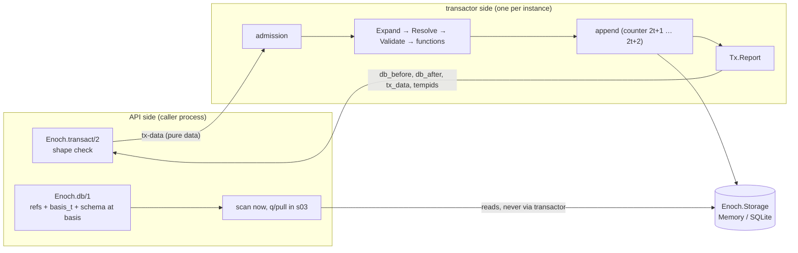

# Handoff — open s02 with the API/transactor seam as the design spine

> **Mission:** finish the owner's s01 acts, then open s02 (schema and transaction semantics, D22) and start its `01_grilling` with the API/transactor seam below as the first agenda item. The goal is for the s02 ADRs to fix where each piece of the write pipeline runs before any code is written. **Avoid:** a network transport, a second OTP app or a "peer server" in e01. Also avoid touching `lib/` or `test/` before an s02 issue authorizes it, and closing s01 issues or stage sheets; those are the owner's acts.

## Origin and state

s01 delivered the `Enoch.Storage` contract, the `Memory` adapter, the per-instance tree (owner, admission, transactor), raw `add`/`retract`, recovery after a transactor crash, boot steps 1, 2, 3 and 7 plus the step 4 mechanism, and `use Enoch.Repo`. The full scope is in `../../06_review/handovers/pr.md`, "Scope".

- Decisions: `docs/_sprints/s01-nucleo-enoch/01_grilling/handovers/decisoes.md` (D22 defines the five e01 sprints)
- ADRs: `docs/adr/` (0001–0010, accepted)
- Spec and tickets: `../../03_spec/handovers/spec.md` (R1–R37), `../../04_tickets/handovers/tickets.md` (F1–F9 = #2–#10)
- Review and fixes: `../../06_review/handovers/revisao.md` (findings R01–R20, fix issue #11), `../../06_review/handovers/correcoes.md`
- Notation in this file: `R1`–`R37` are spec requirements; review findings are always written "review finding R01"–"R20". The numbers collide (spec R13 is admission, review finding R13 is the same-datom conflict).
- Glossary: `CONTEXT.md`. Canon: `docs/canon.md`. Folder tree and sprint per folder: `docs/arquitetura.md`
- Commits: `5807bcf` on `origin/main` (s01 code, pushed with no PR). The #11 fixes are in the working tree and not committed.

## Current situation

Observed on 2026-10-22 on `main` with the uncommitted working tree:

| Check | Observed |
| --- | --- |
| `mix test` | `Result: 70 passed` |
| `mix compile --force --warnings-as-errors` (dev) | rc 0 |
| `sh docs/_index/estado.sh` | `s01-nucleo-enoch [em-curso]`; the step sheets 01–06 are `fechado`; 07 was `vazio` before this handoff |
| `gh issue list --state all` | #1–#11 all `OPEN` |
| `git status` | 45 modified and 7 untracked paths, among them `test/enoch/instance/boot_test.exs`, `owner_test.exs`, `test/enoch_test.exs`, `test/support/boot_adapter.ex`, `test/enoch/adapters/CONTEXT.md` and `06_review/handovers/` |

Nothing else was run for this handoff. The broader evidence (six seeded runs, reproduction scripts, `hex.audit`) comes from the review and is recorded in `revisao.md` under "State of #11". `nix run .#test`, `nix run .#estado` and a full `nix flake check` were never run (see `pr.md`, "Not run").

### What the owner still has to do to close s01

1. #11: accept it on the recorded checks, or reopen it (`revisao.md`, "Pending for the owner", item 1).
2. Commit the working tree on a branch and open the PR with the body in `pr.md`. After that, run the nix commands, because nix reads only the git tree.
3. Confirm the sprints of the work items (`revisao.md`, "Work items"). One of them belongs to s02: review finding R13 (conflicting operations on one datom, retraction of a non-live datom), which `revisao.md` ties to spec R11 and `Enoch.Tx.Resolve`.
4. Close #1–#11.
5. Read this handoff, accept or adjust the `handoff` gate receipt (`jev.jsonl` in this stage), and close `07_handoff`.

## Next work: s02 and the API/transactor seam

### What Datomic splits and where Enoch stands

Datomic Pro runs two stacks against one storage service. The **peer** (or a client talking to a peer server) is the application side. It holds the query engine and reads storage directly. The **transactor** is a single process that serializes writes and builds indexes. Datomic Local is the embedded variant, with writes in the embedded library and no server. Sources, read on 2026-10-22: `docs.datomic.com/datomic-overview.html` (comparison table), `reference/clients-and-peers.html`, `transactions/transaction-processing.html`. The Enoch column below comes from reading the cited files, not from running them.

e01 is shaped like Datomic Local: one embeddable package (D23, ADR-0009). Inside that package, both sides already exist. The contract between them is still informal.

| Datomic | Enoch today (s01) | Gap for s02 |
| --- | --- | --- |
| Connection (`d/connect`) | the instance name (`Enoch.start_link(name: ...)`, D32) | none |
| Peer read: `d/db` is an immutable value; query and index access run locally | `Enoch.db/1` returns table refs and `basis_t` (`lib/enoch/db.ex`); scans run in the caller's process on `:public` ETS (`lib/enoch/adapters/memory.ex:105`), never through the transactor | acquiring the `db` is a `GenServer.call` to the owner (review finding R18, s05) |
| Single transactor, serial, CAS against storage | `Enoch.Transactor`, one per instance (ADR-0004); write order bracketed by the base counter (ADR-0003) | none |
| tx-data: pure data (maps, lists, string tempids, lookup refs, function idents) | raw lists `[:add, e, a, v]` (`Enoch.Transactor.operation/0`) | the s02 forms (R11) must stay pure data |
| Transaction result: `:db-before`, `:db-after`, `:tx-data`, `:tempids` | `{:ok, t}` (`lib/enoch.ex:92`) | tempids need a richer return; `lib/enoch/tx/report.ex` is already in `docs/arquitetura.md` |
| Transaction functions run in the transactor and are called by ident | behaviour only (`lib/enoch/tx/function.ex`); registered by name `{nome, módulo}` (D35, R12) | registration and calls in s02, limits in s05 |
| Schema is datoms in the db, so every peer sees it through its `db` value | not built; the tree has `schema/registry.ex` (D24, D31) | where readers get the schema from |
| Peers: flow control "up to you"; clients: "busy" errors | admission `{:error, :admission_full}` before the mailbox (ADR-0004) | none |
| Timeout: the peer does not know whether the transaction landed | same, documented in `Enoch.Transactor` (ADR-0004) | none |
| `tx-report-queue` sends every report to every peer | none | events are e02 (D5) |
| Storage is a separate service; `datomic:mem` is process-local | `Memory` is local to the node (D18) | a split across nodes needs a network adapter (e02) |

### Proposal for s02 [PROPOSAL from the agent; nothing here is decided]

The concept enters s02 as a **seam inside the one package, not as two deployables**. Everything that needs the latest basis runs on the transactor side. Everything else runs on the API side. Only data crosses between them.

- **S1. tx-data is pure data.** Maps, operation lists, string tempids, lookup refs `[attr value]`, and functions called by registered name (D35). No closures and no pids. Then a later move of the transactor to another node changes the transport, not the semantics.
- **S2. The write semantics run in the transactor, at the serialization point.** `Tx.Expand`, `Tx.Resolve` (tempids, lookup refs, implicit cardinality-one retraction, uniqueness and upsert, `immutable`, `:db/retractEntity`, and the same-datom conflicts of review finding R13), `Tx.Validate` and transaction functions all run there. `Resolve` needs the latest basis, and ADR-0004 puts the rules in one place. Datomic does the same. The API side checks only the shape. Moving `Expand` to the caller to lighten the transactor waits for the throughput measurement that ADR-0004 already postpones to s04/s05.
- **S3. The transactor returns a report.** `Enoch.Tx.Report` carries `db_before`, `db_after`, `tx_data` and `tempids`. It replaces `{:ok, t}` in `Enoch.transact/2`, `Enoch.Transactor.transact/3` and the `Repo` layer. R11's tempid acceptance needs it anyway. e02 events then publish the same struct, and nothing new has to be designed for them.
- **S4. Readers get the schema from the `db` value, not from the transactor.** Schema is datoms (D31 data form, D11 bootstrap). If `schema/registry.ex` exists, it is a cache keyed by `basis_t` and rebuilt from the log, never a source (ADR-0010). A reader at basis `b` sees the schema as of `b`.
- **S5. The physical split stays out of e01.** That covers a transactor on another node, remote peers, a client/peer-server protocol and a report queue. It becomes an e02 grilling input. It depends on a network storage adapter (Postgres/MySQL, e02), because the `Memory` `db` value is ETS refs local to one node (D18). The e02 constraint "one transactor per database" (ADR-0004, D14) stays.

### s02 scope (pointers, not copied)

- D22, s02 bullet and its updates (D29, D33, D34/D35) in `decisoes.md`.
- Spec requirements marked `Sprint: s02` in `spec.md`: R9, R10, R11 (the part after raw), R12 (registration and calls), R18, R19, R21, R22, R24 (functions), R25 (schema metadata), R30, R31 (functions in step 4, step 5).
- From the review: review finding R13 (`revisao.md`, "Work items").

A possible order, for `04_tickets` to confirm: (1) seam ADR and `Tx.Report` with the `transact` return migrated; (2) schema as data, bootstrap and installer (boot step 5); (3) types and `:decimal` in `Validate`; (4) `Resolve`; (5) function registration by name and `cas`; (6) transaction metadata.

## Constraints that need the owner's decision

- **Q1.** Does the seam (S1–S4) become an ADR in s02's `02_domain`, extending ADR-0004?
- **Q2.** `Enoch.transact/2` changes from `{:ok, t}` to a report. It is a breaking change to the s01 API. The callers are `lib/enoch.ex`, `lib/enoch/repo.ex`, `lib/enoch/transactor.ex`, six test files (`test/enoch_test.exs`, `repo_test.exs`, `memory_recovery_test.exs`, `admission_test.exs`, `boot_test.exs`, `owner_test.exs`), and `docs/review-guide.md` §3, §4.4, §4.6 and §4.7.
- **Q3.** Does `Expand` run in the transactor (S2, one semantics) or in the caller (less load on the transactor)?
- **Q4.** Does the reader's schema come from the `db` value (S4) or from a registry process?
- **Q5.** Confirm that the physical split is e02. Does e02 also get a "remote API" item (the analogue of Datomic's client and peer server), next to Absinthe and Ash?
- The s02 slug. Suggestion: `s02-schema-e-transacao`.
- Carried from the review, still open: how to treat a commit that changes its own judging contract (`revisao.md`, review finding R20).

## First steps

1. Owner: the five s01 acts above.
2. Open s02 as described in `docs/PROCESS.md`, "Abrir uma sprint", with `epico: e01-nucleo-enoch`, and add it to `docs/_index/sprints.md`. In `01_grilling/inputs/README.md`, point to this file's "Next work" section instead of copying it.
3. In the grilling, settle Q1–Q5 first, then the D22 s02 items.
4. Useful tools: `/icm status` and `sh docs/_index/estado.sh` for state, the `grilling` Jev gate before the owner's gate, `graphify query` for the code map (`Enoch.transact` → `Enoch.Transactor.transact/3` → `Admission` → `handle_call` → `Memory.append/2`), and the `54-code-explorer` role to trace the transactor path before slicing.

## Risks and open questions

- **The Datomic analogy has a limit.** Datomic peers keep a memory index of recent changes pushed by the transactor. Enoch readers on one node read the same ETS tables the transactor writes, guarded by the base counter (ADR-0003), so nothing needs to be broadcast. With network storage in e02, caching and change propagation become real design work, and s02 does not solve them.
- **The read path still has one mailbox.** `Enoch.db/1` goes through the owner's mailbox (review finding R18, assigned to s05). If S4 caches the schema in the owner, that mailbox also gets the schema load. Keep the cache out of the owner, or move review finding R18 earlier.
- **Review finding R13 is silent today.** `Memory` keys history rows on `{e, a, v, tx}`, so `[[:add,1,10,7],[:retract,1,10,7]]` collapses into one row (`revisao.md`, review finding R13). `Resolve` must reject conflicting operations before `append`; otherwise the collapse stays silent.
- **The judge is not calibrated.** Jev runs with `calibrado: false` (`docs/agents/jev.md`), so its receipts are leads, not approval.

No secrets, credentials or personal data in this file.
